<div align="center">

<picture>
  <source media="(prefers-color-scheme: dark)" srcset=".github/assets/banner-dark.svg">
  
</picture>

**Fast images, predictable memory, native scrolling.**<br>
Load, resize, cache, cancel, and recycle remote or sandboxed images through mature native pipelines, without bundling a feed framework.

[](https://packagist.org/packages/pushinbr/pam-native-image)
[](https://github.com/push-in/pam-native-image/releases/latest)

[](https://github.com/push-in/pam-native-image/actions/workflows/ci.yml)
[](LICENSE)

[Install](#install) · [Quick example](#quick-example) · [Platforms](#platform-support) · [Requirements](#requirements) · [Docs](#docs) · [Issues](https://github.com/push-in/pam-native-image/issues)

</div>

<a id="install"></a>
## <picture></picture> Install

Inside a PAM Native project, add only this capability:

```sh
pam composer require pushinbr/pam-native-image
pam doctor --fix
```

New to PAM? Create a project with `pam init my-app --template native` (see the [PAM Native overview](https://push-in.github.io/pam-docs/native/overview/)), then come back here. Composer owns the manifest and the lockfile; `pam composer` runs it on PAM's verified PHP runtime.

<a id="quick-example"></a>
## <picture></picture> Quick example

```php
use Pam\Native\Image\ImageCachePolicy;
use Pam\Native\Image\ImageContentMode;
use Pam\Native\Image\NativeImage;

return NativeImage::make('https://cdn.example.com/poster.webp')
    ->contentMode(ImageContentMode::Cover)
    ->cachePolicy(ImageCachePolicy::MemoryAndDisk)
    ->crossfade(120);
```

The decoder, resizing, cancellation, memory and disk caching, and recycled-view safety stay native. Content modes: `Contain`, `Cover`, `Fill`, `Center`. Cache policies: `MemoryAndDisk`, `Memory`, `Disk`, `Disabled`. `onEvent()` reports `ImageEventKind::Loaded` or `Failed`.

<a id="platform-support"></a>
## <picture></picture> Platform support

| Platform | Support | Notes |
| --- | --- | --- |
| Android | API 26+ | Coil 3.3.0 (OkHttp network) |
| iOS | 15.0+ | SDWebImage 5.21.7 |
| PAM Native | 0.8.0 to < 2.0.0 | From `pam-native.plugin.json`; PHP 8.5+ |

<a id="requirements"></a>
## <picture></picture> Requirements and production rules

No runtime permissions are declared on Android or iOS.

- Sources must be HTTPS or sandbox-relative.
- Always provide semantic image descriptions in the surrounding PAM UI surface.
- Test low-memory eviction and offline behavior, and run `pam production certify` before release.

<a id="what-you-can-build"></a>
## <picture></picture> What you can build

- Poster walls and media catalogs
- Product grids, avatars, and social timelines
- Offline-aware, memory-bounded image surfaces

It is a horizontal primitive and never installs a feed or application template.

| | |
| --- | --- |
| **Native path** | Coil 3 · SDWebImage |
| **Application model** | Composer package + generated native integration |
| **Design rule** | Independent module; no feed, vertical, or application template bundled |

<a id="docs"></a>
## <picture></picture> Docs

- [PAM Native overview](https://push-in.github.io/pam-docs/native/overview/)
- [PAM introduction](https://push-in.github.io/pam-docs/introduction/)
- [Changelog](CHANGELOG.md)
- [Report an issue](https://github.com/push-in/pam-native-image/issues)

<a id="pam-ecosystem"></a>
## <picture></picture> Part of the PAM ecosystem

PAM runs PHP natively on servers, desktops and phones. This repository is one piece of it.

| [**PAM**](https://github.com/push-in/pam) | [**PAM Desktop**](https://github.com/push-in/pam-desktop) | [**PAM Native**](https://github.com/push-in/pam-native) | [**Ecosystem**](https://github.com/push-in/pam#ecosystem) |
| --- | --- | --- | --- |
| the runtime and CLI | native desktop apps in PHP | native Android and iOS apps in PHP | every official package and plugin |

<sub>Docs: [push-in.github.io/pam-docs](https://push-in.github.io/pam-docs/introduction/) · [Issues](https://github.com/push-in/pam-native-image/issues)</sub>

<p align="center"><sub><a href="LICENSE">Apache License 2.0</a> · Made in Brazil by Pushin</sub></p>
